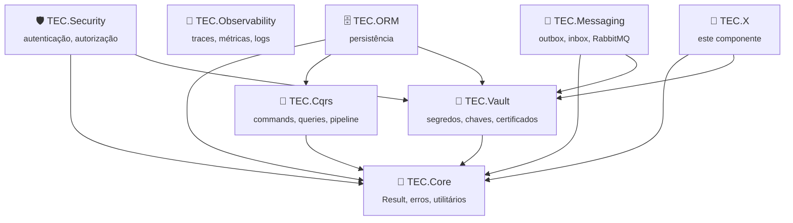

<div align="center">


[🏠 Tudo em Código](https://github.com/tudoemcodigo) › [📦 TEC.X](https://github.com/tudoemcodigo/TEC.X)

# TEC.X

> Breve descrição do valor do componente: o problema que resolve e para quem.

[](https://github.com/tudoemcodigo/TEC.X/actions/workflows/ci.yml)
[](docs/compatibilidade.md)
[](docs/compatibilidade.md)
[](CHANGELOG.md)
[](https://github.com/orgs/tudoemcodigo/packages)
[](README.md#-seguran%C3%A7a)
[](LICENSE)

</div>

## 📑 Sumário

- [✨ Por que usar](#-por-que-usar)
- [📦 Pacotes](#-pacotes)
- [🧬 Ecossistema TEC](#-ecossistema-tec)
- [📥 Instalação](#-instalação)
- [🚀 Início rápido](#-in%C3%ADcio-r%C3%A1pido)
- [📚 Documentação](#-documenta%C3%A7%C3%A3o)
- [⚡ Compatibilidade](#-compatibilidade)
- [🛡️ Segurança · 🧪 Testes](#️-seguran%C3%A7a--testes)
- [🤝 Contribuição · 🏷️ Versionamento · 📄 Licença](#-contribuição--versionamento--licença)

---

## ✨ Por que usar

| Sem TEC.X | Com TEC.X |
|---|---|
| Problema manual/repetitivo | Solução pronta, testada e observável |
| Coupling com infraestrutura | Abstrações limpas, trocáveis em testes |
| Observabilidade ad-hoc | `ActivitySource`/`Meter` nativos (BCL) |

- **Resiliente**: timeouts, retries, circuit breaker configuráveis
- **Seguro**: sem segredos em logs, validação de entrada, comparação em tempo constante
- **Observável**: traces, métricas e logs estruturados prontos para OpenTelemetry

---

## 📦 Pacotes

| Pacote | Para que serve | Quando instalar | Depende de |
|---|---|---|---|
| `TEC.X` | Núcleo: abstrações e implementação principal | Sempre | `TEC.Core` |
| `TEC.X.AspNetCore` | Integração ASP.NET Core (DI, middleware, filters) | Apps ASP.NET Core | `TEC.X`, `Microsoft.Extensions.DependencyInjection` |
| `TEC.X.Azure` | Integração Azure (Key Vault, Managed Identity) | Apps no Azure | `TEC.X`, `Azure.Identity` |

---

## 🧬 Ecossistema TEC



---

## 📥 Instalação

Feed: **GitHub Packages** (`https://nuget.pkg.github.com/tudoemcodigo/index.json`)

```bash
# PAT com escopo read:packages
dotnet nuget add source https://nuget.pkg.github.com/tudoemcodigo/index.json -n github -u SEU_USUARIO -p SEU_PAT

dotnet add package TEC.X
# ou
dotnet add package TEC.X.AspNetCore
# ou
dotnet add package TEC.X.Azure
```

---

## 🚀 Início rápido

```csharp
// Exemplo mínimo funcionando
using TEC.X;

var service = new XService();
var result = await service.DoSomethingAsync("input");
```

---

## 📚 Documentação

| Arquivo | O que responde |
|---|---|
| [📐 Uso](docs/uso.md) | Exemplos completos de API |
| [⚙️ Opções](docs/opcoes.md) | Tabela: opção, padrão, descrição |
| [❌ Erros](docs/erros.md) | Código/exceção, quando ocorre, o que fazer |
| [🛡️ Segurança](docs/seguranca.md) | Armadilhas e boas práticas |
| [⚡ Compatibilidade](docs/compatibilidade.md) | .NET 8/10, AOT, sem ICU, sistemas |

---

## ⚡ Compatibilidade

- **Frameworks**: `net8.0`, `net10.0` (LTS)
- **Native AOT**: Compatível (exceto onde documentado)
- **Globalization**: Modo *invariant* suportado (sem ICU)
- **Sistemas**: Linux, Windows, macOS (x64, arm64)

---

## 🛡️ Segurança · 🧪 Testes

- **SAST**: CodeQL `security-extended` em todo PR e push na `main`
- **Supply chain**: `NuGetAudit`, `packageSourceMapping`, lock file, actions fixadas por SHA
- **Testes**: TUnit, categorias `Integracao`, `Carga-CI`, `Carga-Pesada`, `Seguranca-Pesada`

---

## 🤝 Contribuição · 🏷️ Versionamento · 📄 Licença

- **Contribuição**: PRs bem-vindos; rode `scripts/validate-conventions.sh` antes de commitar
- **Versionamento**: [SemVer 2.0](https://semver.org/lang/pt-BR/) — prévias `preview.N` no CI, releases manuais via `release.yml` (exige aprovação no environment `publicacao`)
- **Licença**: [Apache 2.0](LICENSE) — consulte `NOTICE` para informações de atribuição do projeto

---

*Template mantido em [tudoemcodigo/tec-workflows](https://github.com/tudoemcodigo/tec-workflows).*
